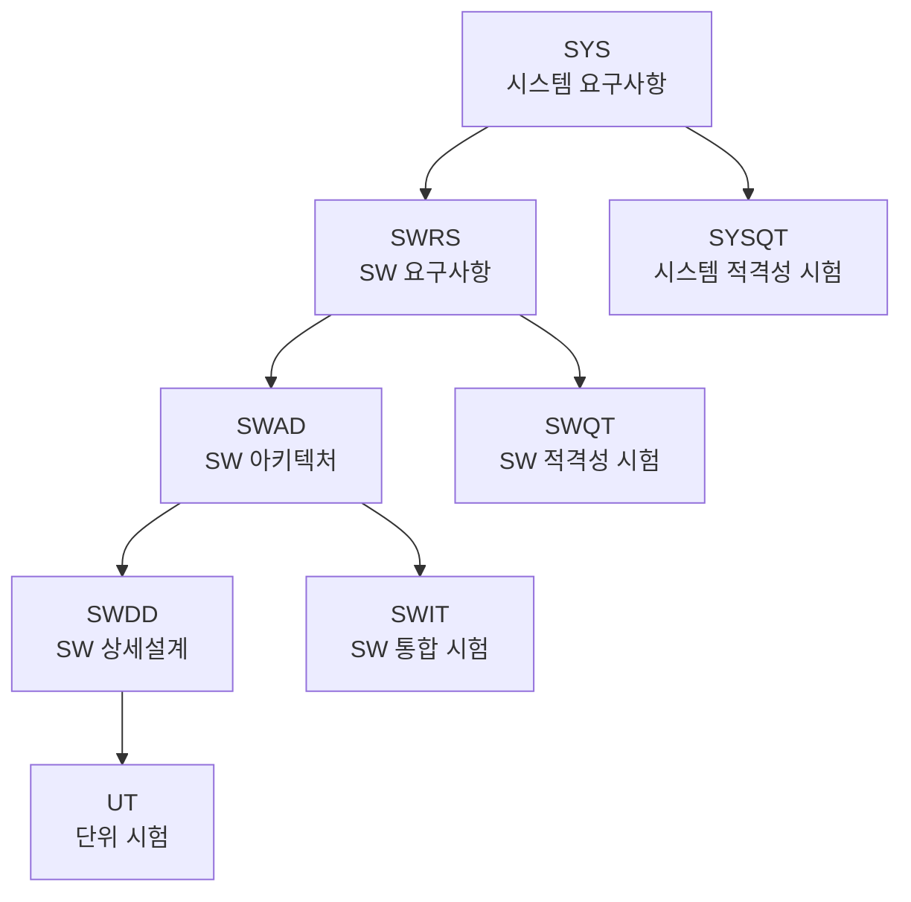

요구사항, 설계, 시험 명세를 코드와 같은 Git 저장소에서 관리하고 싶을 때 쓸 수 있는 도구가 [Doorstop](https://github.com/doorstop-dev/doorstop)이다. 이 글에서는 Doorstop의 용도와 기능을 정리하고, Doorstop으로 소프트웨어 V 모델의 명세와 추적성을 구성하는 방법을 살펴본다.

## Doorstop이란

Doorstop은 Python으로 만든 오픈소스 **요구사항 관리 도구**다(`pip install doorstop`). 요구사항을 별도 DB가 아니라 **Git 저장소 안의 텍스트 파일**로 관리한다.

- 요구사항 하나가 파일 하나(YAML 또는 Markdown)다. 그래서 코드와 같은 저장소에서 같은 브랜치·PR 흐름으로 리뷰하고 이력을 남길 수 있다.
- DOORS나 Polarion 같은 상용 도구 없이 요구사항부터 설계, 시험까지의 **추적성(traceability)**을 남기는 것이 주된 용도다.
- 작은 팀이나 개발자 중심 조직에서 "명세도 코드처럼(docs-as-code)" 관리하려 할 때 잘 맞는다.

## 핵심 개념

| 개념 | 설명 |
|---|---|
| **Document** | 요구사항 묶음(예: 시스템 요구사항 `SYS`, SW 요구사항 `SWRS`). 디렉터리 하나이고 설정 파일 `.doorstop.yml`이 들어 있다. |
| **Prefix / UID** | 문서 접두어와 번호를 합친 항목 ID다(`SYS001`, `SWRS-0012` 등). |
| **Parent 문서** | 각 문서는 **부모 문서를 하나만** 가진다. 그래서 문서 구조는 트리가 된다. |
| **Item** | 개별 요구사항 파일이다(`SYS001.yml`). 본문(`text`), 레벨, 링크, 사용자 정의 속성을 담는다. |
| **Link** | 자식 항목이 부모 항목을 가리키는 링크다(`SWRS001 → SYS001`). |
| **level** | 문서 안의 장·절 번호다(`1.2.3`). 출판할 때 목차 순서가 된다. |
| **header / normative** | 제목만 있는 항목, 또는 요구사항이 아닌 설명용 항목을 표시한다. |
| **derived** | 부모 없이 하위 단계에서 새로 생긴 요구사항(파생 요구사항)을 표시한다. |
| **references** | 소스 파일이나 테스트 코드 경로를 연결한다. 검증할 때 파일이 실제로 있는지 확인한다. |

항목 파일은 다음과 같은 모양이다.

```yaml
# spec/swrs/SWRS001.yml
active: true
derived: false
header: Certificate Validation
level: 2.1
links:
- SYS003: 7f3a...   # 부모 항목의 지문(fingerprint)
normative: true
reviewed: 9c1e...
text: |
  The software shall reject a certificate whose validity period has expired.
references:
- path: src/main/java/example/CertValidator.java
  type: file
```

## 주요 기능

### 트리 구조 검증

인자 없이 `doorstop`을 실행하면 전체 트리를 검사한다.

- 끊어진 링크, 중복 UID, 레벨 오류를 잡아낸다.
- 하위 문서에서 아무도 링크하지 않은 부모 항목을 알려준다. 커버리지 누락을 찾는 데 쓸 수 있다.
- 오류가 있으면 0이 아닌 종료 코드를 반환하므로 **CI 게이트**로 쓰기 좋다.

### Suspect link (변경 영향 추적)

- 링크에는 부모 항목의 지문(해시)이 저장된다.
- 부모 요구사항이 바뀌면 자식 링크가 suspect로 표시된다. 영향받는 설계와 시험을 다시 검토하라는 신호다.
- 검토가 끝나면 `doorstop clear`로 표시를 해제하고, `doorstop review`로 항목을 리뷰 완료 상태로 둔다.

### 출판

`doorstop publish`로 HTML, Markdown, LaTeX, 텍스트 형식의 명세서를 만든다. `publish all`을 쓰면 문서 전체와 추적성 매트릭스까지 생성한다.

### 가져오기 / 내보내기

`doorstop import` / `doorstop export`로 xlsx, csv, tsv와 주고받는다. 엑셀로 요구사항을 받는 고객사와 협업할 때 쓸 수 있다.

### 사용자 정의 속성

`.doorstop.yml`에서 속성 기본값을 정한다(예: `verification-method`, `asil`, `priority`). 출판 대상 속성과 리뷰 지문에 포함할 속성도 지정할 수 있다.

### 기타

간단한 GUI(`doorstop-gui`), REST 서버(`doorstop-server`), Python API(`import doorstop`)를 제공한다. Python API로 별도 검증 스크립트를 짤 수 있다.

## Doorstop으로 V 모델 구성하기

### V 모델과 문서 대응

V 모델의 왼쪽은 명세, 오른쪽은 그 명세를 검증하는 시험이다. 같은 높이의 명세와 시험이 서로 짝을 이룬다.

| 단계 | 명세 문서 (좌측) | 검증 문서 (우측) |
|---|---|---|
| 시스템 | `SYS` 시스템 요구사항 | `SYSQT` 시스템 적격성 시험 |
| SW 요구사항 | `SWRS` SW 요구사항 | `SWQT` SW 적격성 시험 |
| SW 아키텍처 | `SWAD` SW 아키텍처 설계 | `SWIT` SW 통합 시험 |
| SW 상세설계 | `SWDD` SW 상세설계 | `UT` 단위 시험 |

### 핵심 설계: 시험 문서를 같은 단계 명세 문서의 자식으로 두기

Doorstop은 **부모가 하나인 트리**이고, 링크도 **자식 항목이 부모 문서의 항목을 가리키는 방향**을 전제로 검증한다. 따라서 V 모델의 가로 관계(명세 ↔ 시험)는 **시험 문서의 parent를 같은 단계의 명세 문서로 지정**해서 표현한다.



이렇게 두면 세로 링크(요구사항 분해)와 가로 링크(검증)가 모두 "자식 → 부모" 링크가 되어 Doorstop 검증 규칙과 맞는다.

### 생성 명령 예시

```bash
git init

# 좌측(명세)
doorstop create SYS   ./spec/sys
doorstop create SWRS  ./spec/swrs  --parent SYS
doorstop create SWAD  ./spec/swad  --parent SWRS
doorstop create SWDD  ./spec/swdd  --parent SWAD

# 우측(검증)
doorstop create SYSQT ./verif/sysqt --parent SYS
doorstop create SWQT  ./verif/swqt  --parent SWRS
doorstop create SWIT  ./verif/swit  --parent SWAD
doorstop create UT    ./verif/ut    --parent SWDD

# 항목 추가와 링크
doorstop add SYS              # SYS001 생성
doorstop add SWRS             # SWRS001 생성
doorstop link SWRS001 SYS001  # 분해 링크
doorstop add SWQT
doorstop link SWQT001 SWRS001 # 검증 링크

doorstop                      # 트리 검증
doorstop publish all ./public # HTML 명세서와 추적성 매트릭스 생성
```

### 실무 운영 팁

- **시험 명세와 시험 코드 연결**: 시험 항목(`UT001` 등)의 `references`에 실제 테스트 파일 경로를 넣는다. 그러면 "요구사항 → 시험 명세 → 테스트 코드"까지 이어진다. 테스트 코드 주석이나 메서드 이름에 UID를 함께 적어 두면 반대 방향 추적도 쉬워진다.
- **검증 방법 속성**: `verification-method: test | analysis | inspection | demonstration` 같은 속성을 기본값으로 정의해 두면, 시험이 아닌 방법으로 검증하는 요구사항도 구분할 수 있다.
- **커버리지 점검**: `doorstop`은 자식 문서에서 링크되지 않은 항목을 경고한다. 다만 `SWRS`처럼 자식 문서가 둘 이상(`SWAD`, `SWQT`)인 경우가 문제다. "설계로는 분해됐지만 시험이 없는" 요구사항까지 확실히 잡으려면, Python API로 "각 `SWRS` 항목에 `SWQT` 링크가 있는가"를 확인하는 스크립트를 CI에 하나 추가하는 편이 좋다.
- **파생 요구사항**: 아키텍처나 상세설계 단계에서 새로 생긴 요구사항(보안상 필요한 내부 검증 로직 등)은 `derived: true`로 표시한다. 이렇게 하면 부모가 없다는 경고를 피하고 별도로 관리할 수 있다.
- **변경 관리 흐름**: 요구사항 수정 PR을 올리면 CI에서 `doorstop`을 실행해 suspect link를 드러낸다. 영향받는 설계·시험을 검토한 뒤 `doorstop clear`를 같은 PR에 포함한다. 이렇게 하면 변경 영향 분석 기록이 Git 이력에 남는다.
- **Automotive SPICE 대응**: 위 문서들은 대략 SYS.2/SYS.5, SWE.1/SWE.6, SWE.2/SWE.5, SWE.3/SWE.4에 대응한다. 양방향 추적성과 일관성 증적을 `publish` 결과물과 Git 이력으로 제시할 수 있다.

## 한계와 대안

- **단일 부모 트리**: 문서 하나가 여러 부모를 가질 수 없다(예: 하나의 시험 문서가 `SWRS`와 `SWAD`를 동시에 검증). 위처럼 시험 문서를 단계별로 나눠야 한다.
- **표준 교환 포맷 미지원**: ReqIF를 기본으로 지원하지 않는다. 고객사가 DOORS나 Polarion에서 ReqIF로 주고받는다면 불편하다.
- **도구 기능 제한**: GUI와 출판 서식이 단순하고, 승인 워크플로·권한 관리는 Git 호스팅(PR 리뷰)에 의존한다.
- **대안**
  - **StrictDoc**: ReqIF를 지원하고 다중 관계 표현이 더 유연하다.
  - **sphinx-needs**: Sphinx 문서와 통합된다.
  - **OpenFastTrace**: 코드 태그 기반 추적에 강하다.

## 정리

Doorstop으로 V 모델을 운영하는 기본 패턴은 다음 두 가지다.

1. 문서 트리를 "명세 문서 아래에 같은 단계의 시험 문서를 자식으로 둔다"는 원칙으로 설계한다.
2. 검증(`doorstop`)과 출판(`doorstop publish`)을 CI에 넣어, 추적성 누락과 변경 영향을 PR 단계에서 드러낸다.
